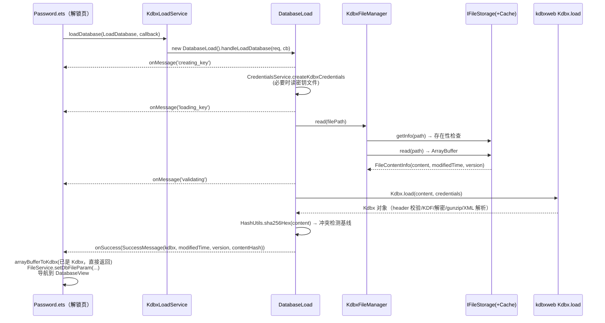
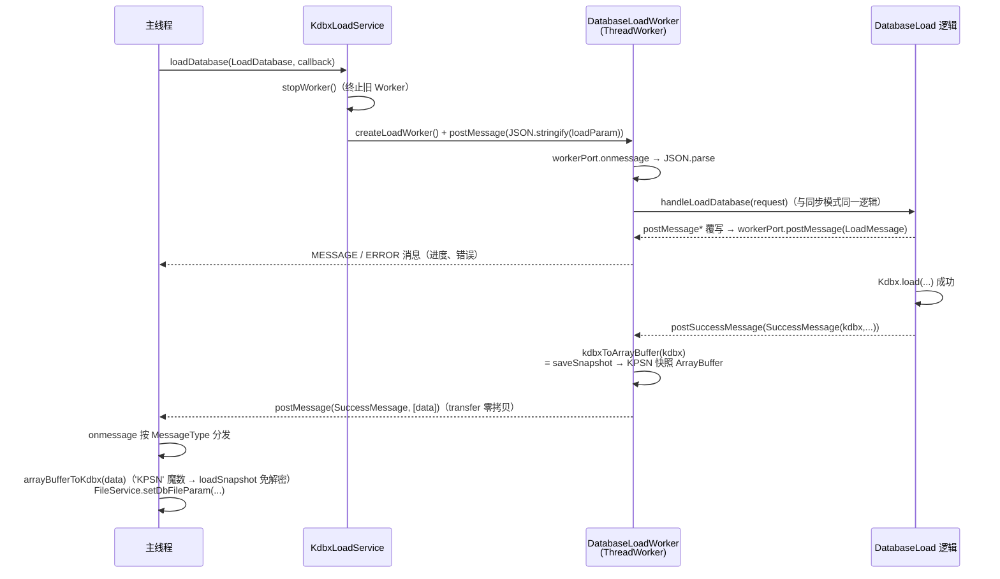
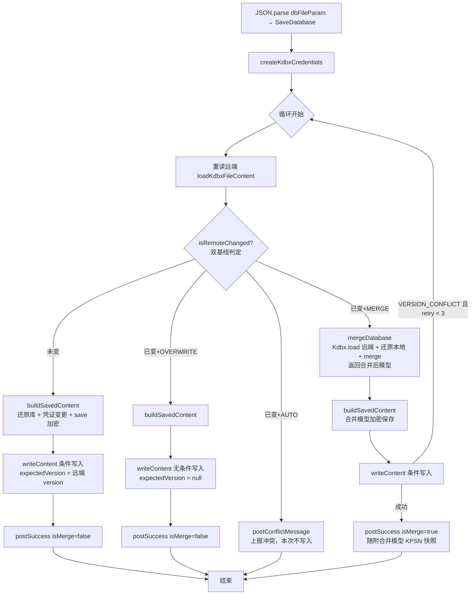

# KDBX 文件存储与加载流程分析

> 分析范围：`entry/src/main/ets` 下的 kdbx 服务层、workers、storage 层，以及 `libs/kdbxweb` 格式库。
> 本文所有 `文件:行号` 均相对仓库根目录，基于当前代码现状整理。
> 2026-10-05 更新：Worker 跨线程边界已由"未加密 XML"切换为 **KPSN 二进制快照**（见 §3.4）；生产开关 `ASYNC_*` 仍为关闭（同步模式）。

---

## 1. 总览

KDBX 数据库文件的加载与保存采用**分层架构**，从上到下分为六层：

```
┌─────────────────────────────────────────────────────────────┐
│ UI 层        Password.ets（解锁）/ DatabaseView.ets（刷新）/ 各编辑页（保存） │
├─────────────────────────────────────────────────────────────┤
│ 编排层       KdbxLoadService / KdbxSaveService（同步/异步模式开关）        │
│             FileService（内存中的 DbFileParam + 冲突检测基线）            │
├─────────────────────────────────────────────────────────────┤
│ 任务层       DatabaseLoad / DatabaseSave（两种模式共用的核心业务逻辑）      │
├─────────────────────────────────────────────────────────────┤
│ Worker 壳层   DatabaseLoadWorker / DatabaseSaveWorker（异步模式的线程入口）│
├─────────────────────────────────────────────────────────────┤
│ 文件访问层    KdbxFileManager → FileStorageFactory → IFileStorage 实现    │
│             （Local / WebDAV / S3 / OneDrive / FTP / 华为云盘 + Cache 装饰器）│
├─────────────────────────────────────────────────────────────┤
│ 格式层       libs/kdbxweb（Kdbx.load / save / merge / KPSN 快照 saveSnapshot·loadSnapshot）│
└─────────────────────────────────────────────────────────────┘
```

**核心设计**：任务层 `DatabaseLoad` / `DatabaseSave` 是两种执行模式共用的业务实现，通过**模板方法模式**解耦消息投递——同步模式由基类直接回调，异步模式由 Worker 子类覆写 `postMessage*` 系列方法改为 `workerPort.postMessage` 跨线程投递。

---

## 2. 核心组件与职责

| 组件 | 文件 | 职责 |
|---|---|---|
| `KdbxLoadService` | `entry/src/main/ets/services/kdbx/KdbxLoadService.ets` | 加载入口；按 `Constants.ASYNC_LOAD_DATABASE` 分流同步/异步；持有加载 Worker |
| `KdbxSaveService` | `entry/src/main/ets/services/kdbx/KdbxSaveService.ets` | 保存入口；按 `Constants.ASYNC_SAVE_DATABASE` 分流；冲突弹框编排；持有保存 Worker |
| `KdbxFileManager` | `entry/src/main/ets/services/kdbx/KdbxFileManager.ets` | 文件访问薄封装：读（存在性检查 + 内容）、条件写、getInfo |
| `DatabaseLoad` | `entry/src/main/ets/workers/DatabaseLoad.ets` | 加载核心逻辑：建凭证 → 读文件 → `Kdbx.load` → 计算内容哈希基线 |
| `DatabaseSave` | `entry/src/main/ets/workers/DatabaseSave.ets` | 保存核心逻辑：重读远端 → 双基线冲突判定 → 条件写入 / 合并 / 覆盖 |
| `DatabaseLoadWorker` | `entry/src/main/ets/workers/DatabaseLoadWorker.ets` | 加载 Worker 壳：接收主线程消息，覆写 `postMessage*` 回传结果 |
| `DatabaseSaveWorker` | `entry/src/main/ets/workers/DatabaseSaveWorker.ets` | 保存 Worker 壳：同上 |
| `DatabaseWorkerFactory` | `entry/src/main/ets/workers/DatabaseWorkerFactory.ets` | Worker 工厂；因 `useNormalizedOHMUrl` 约束必须用 `./` 相对路径创建 |
| `FileService` | `entry/src/main/ets/services/FileService.ets` | 单例；内存中的 `DbFileParam`（含数据库对象与版本基线三元组） |
| `CredentialsService` | `entry/src/main/ets/services/CredentialsService.ets` | 按认证方式（密码 / 密钥文件 / 密码+密钥文件）构造 `KdbxCredentials` |
| `FileStorageFactory` | `entry/src/main/ets/storage/FileStorageFactory.ets` | 存储注册表 + 单例工厂；非 LOCAL 存储自动包一层 `CacheStorage` |
| `CacheStorage` | `entry/src/main/ets/storage/cache/CacheStorage.ets` | 远程存储的本地缓存装饰器（离线打开 / 仅缓存模式 / 原子写缓存） |
| `kdbxweb` | `libs/kdbxweb/src/main/ets/format/` | KeePass 格式库：header 解析、KDF 密钥派生、加解密、XML 映射、merge、KPSN 快照序列化/反序列化（`kdbx-snapshot.ts`） |

---

## 3. 两种执行模式：同步 vs 异步

### 3.1 模式开关

`entry/src/main/ets/common/constants/Constants.ets:5-9`：

```ts
public static readonly ASYNC_SAVE_DATABASE: boolean = false;   // 当前：同步保存
public static readonly ASYNC_LOAD_DATABASE: boolean = false;   // 当前：同步加载
```

> **当前两个开关均为 `false`**，即默认走"同步模式"。
> 注意：这里的"同步"并非阻塞式调用——所有 I/O 与加密操作本身仍是 `async/Promise` 驱动的；
> 它的真实语义是 **"是否把 CPU 密集任务搬进 Worker 线程"**：
> - **同步模式**：整个加载/保存在**调用者线程（主线程）**执行，Argon2 密钥派生、AES/ChaCha20 解密、XML 解析等 CPU 密集操作会占用主线程，可能造成 UI 卡顿；
> - **异步模式**：核心任务在 **ThreadWorker 线程**执行，主线程只负责参数序列化与结果回调。

### 3.2 分流机制

```ts
// KdbxLoadService.ets:20-26
public static loadDatabase(loadParam: LoadDatabase, callback?: KdbxLoadServiceCallback): void {
  if (Constants.ASYNC_LOAD_DATABASE) {
    KdbxLoadService.asyncLoadDatabase(loadParam, callback);      // Worker 线程
  } else {
    new DatabaseLoad().handleLoadDatabase(loadParam, callback);  // 主线程
  }
}

// KdbxSaveService.ets:53-59
if (Constants.ASYNC_SAVE_DATABASE) {
  KdbxSaveService.saveDatabaseAsync(saveDatabaseReq, callbackWarp);  // Worker 线程
} else {
  new DatabaseSave(callbackWarp).handleSaveDatabase(saveDatabaseReq); // 主线程
}
```

### 3.3 两种模式对比

| 维度 | 同步模式（当前默认） | 异步（Worker）模式 |
|---|---|---|
| 执行线程 | 主线程（事件循环内） | `ThreadWorker` 线程 |
| 任务逻辑 | `DatabaseLoad` / `DatabaseSave` 基类直接执行 | Worker 子类继承同样逻辑，仅覆写消息投递 |
| 消息传递 | 直接函数回调（`callback.onXxx`） | `postMessage` + 主线程 `onmessage` 按 `MessageType` 分发 |
| 请求数据 | 对象引用直接传递（零序列化） | 序列化后跨线程：加载参数 `JSON.stringify`；保存参数结构化克隆 + transfer list |
| 数据库对象边界 | `Kdbx` 实例引用直接传递 | `Kdbx` ↔ **KPSN 二进制快照 ArrayBuffer** 序列化往返（`kdbxToArrayBuffer` / `arrayBufferToKdbx`） |
| 大 buffer 传输 | 无跨线程拷贝 | transfer list 零拷贝（`postMessage(msg, [buffer])`） |
| UI 影响 | KDF/加解密/XML 解析占用主线程 | 主线程仍需一次 `saveSnapshot` 序列化（异步保存）或 `loadSnapshot` 还原（异步加载回传后；仅一次小 DOM 解析 + 附件直拷，无全文 base64 解码） |
| Worker 生命周期 | 无 | 每次任务新建 Worker；启动前 `terminate()` 旧 Worker（`KdbxLoadService.stopWorker`、`KdbxSaveService.saveDatabaseAsync:196-204`） |

### 3.4 Worker 边界的序列化协议（KPSN 二进制快照）

跨线程传递的数据库内容采用 **KPSN 二进制快照**（`kdbx.saveSnapshot()`，2026-10 起；此前为未加密 XML），而非加密 KDBX：

```ts
// KdbxUtils.ets:313-318 —— Kdbx → ArrayBuffer（KPSN 快照）
public static async kdbxToArrayBuffer(kdbx: Kdbx | ArrayBuffer): Promise<ArrayBuffer> {
  if (kdbx instanceof ArrayBuffer) { return Promise.resolve(kdbx); }
  return kdbx.saveSnapshot();
}

// KdbxUtils.ets:327-345 —— ArrayBuffer → Kdbx（魔数三分发）
public static async arrayBufferToKdbx(arrayBuffer, credentialsParam, credentials?): Promise<Kdbx> {
  if (arrayBuffer instanceof Kdbx) { return arrayBuffer; }
  ...
  if (KdbxSnapshot.isSnapshot(arrayBuffer)) {            // 'KPSN' 魔数 → 快照直接还原（免解密）
    return Kdbx.loadSnapshot(arrayBuffer, credentials);
  }
  try { return await Kdbx.load(arrayBuffer, credentials); }   // 加密 KDBX 文件
  catch (error) { return Kdbx.loadXml(ByteUtils.bytesToString(arrayBuffer), credentials); }  // 遗留明文 XML 兜底
}
```

KPSN 布局（单块连续 ArrayBuffer，小端 18 字节固定头 + 三段，完整规范见 `docs/KDBX跨线程数据传输优化设计-二进制快照协议.md` §4）：

| 段 | 内容 |
|---|---|
| 固定头 | `'KPSN'` 魔数 + formatVersion + headerLength / xmlLength / poolCount |
| Header 段 | `KdbxHeader.write()` 原样输出——**完整保留版本、KDF 参数、cipher 算法** |
| XML 段 | 条目树 XML：附件只写 `Ref` 序号（无 base64 内联）、保护值明文、无 Meta/Binaries 节点 |
| 附件池段 | 按 Ref 序号排序：长度 + 保护标志 + sha256 + 原始字节（无 base64 放大） |

由 XML 切换为 KPSN 的动因（"Worker 侧还需对数据库做 merge 与带凭证的 save()，传解密后的对象模型比传加密文件更直接"这一理由不变）：

- **消除 base64 放大**：旧方案大附件两侧各经历一次 4/3× 编解码；池段改为原始字节直传；
- **修复文件头丢失缺陷**：旧 `saveXml → loadXml` 往返用默认头（`KdbxHeader.create()`）重建，v3 `keyEncryptionRounds`、v4 非默认 KDF 参数等被静默重置（KPSN 设计文档 §1.4）；快照显式携带头段；
- **加载回传侧的重量活消失**：主线程 `loadSnapshot` 仅一次小 DOM 解析 + 附件直拷，不再全文 XML 解析 + 全量 base64 解码；
- **isMerge 回传也走快照**（见 5.2/5.4）：主线程不再对落盘字节做全量重解析（消除主线程 Argon2）。

安全语义不变：快照内容仍是**进程内**明文（条目树明文、附件池明文），暴露程度与旧 XML 边界完全一致。明文 XML 分支保留，兼容遗留缓冲与测试夹具。

---

## 4. 加载流程详解

### 4.1 同步加载时序（当前默认，ASYNC_LOAD_DATABASE = false）



关键步骤（`DatabaseLoad.handleLoadDatabase`，`DatabaseLoad.ets:20-43`）：

1. **构造凭证** `'creating_key'` → `CredentialsService.createKdbxCredentials`（`CredentialsService.ets:21-48`）：
   - 仅密码：`new KdbxCredentials(ProtectedValue.fromString(password))`
   - 密码+密钥文件 / 仅密钥文件：通过 `KdbxFileManager.of(keyLocation).read()` 读取密钥文件内容（密钥文件本身也可位于任意存储类型）
2. **读取文件** `'loading_key'` → `KdbxFileManager.read`（`KdbxFileManager.ets:53-69`）：
   - 先 `storage.getInfo(path)` 检查存在性，不存在抛 `file_not_exists`
   - 再 `storage.read(path)` 读取内容，封装为 `FileContentInfo`（携带 `modifiedTime` 与 `version`）
3. **解密解析** `'validating'` → `Kdbx.load(content, credentials)`（见 4.4）
4. **建立基线** `'loading_complete'` → `HashUtils.sha256Hex(content)` 计算**内容哈希基线**，连同存储原生 `version` 一起放进 `SuccessMessage`，供后续保存做冲突检测（`DatabaseLoad.ets:36-38`）
5. **主线程落地**（`Password.ets:562-613`）：`FileService.setDbFileParam({ database, modifiedTime, version, contentHash, ... })` 写入内存单例，随后导航至 `DatabaseView`。

### 4.2 异步（Worker）加载时序（ASYNC_LOAD_DATABASE = true）



与同步模式的差异点：

- **请求侧**：参数被 `JSON.stringify` 后发送（`KdbxLoadService.ets:39`），Worker 端 `JSON.parse` 还原（`DatabaseLoadWorker.ets:17`）。
- **响应侧**：`DatabaseLoadWorker.postSuccessMessage`（`DatabaseLoadWorker.ets:66-76`）在 Worker 内先把 `Kdbx` 经 `kdbxToArrayBuffer` 序列化为 KPSN 快照 ArrayBuffer，再用 **transfer list `[message.data]`** 零拷贝回传。
- **主线程还原**：收到 `SUCCESS` 后由 UI 侧调用 `KdbxUtils.arrayBufferToKdbx` 按魔数分发：KPSN → `loadSnapshot` 直接还原（免解密，一次小 DOM 解析）；KDBX / 明文 XML → `load` / `loadXml` 兜底。
- **异常通道**：`onAllErrors` 忽略 `NativeCustomSpan` / `ViewV2` 噪声错误（`KdbxLoadService.ets:67-79`）；`onexit` 用于 Worker 销毁后关闭加载弹框。
- **Worker 生命周期**：加载 Worker 完成任务后**不主动销毁**，下一次 `loadDatabase` 前 `stopWorker()` 终止（`KdbxLoadService.ets:33-34, 134-145`）。

### 4.3 其他加载入口

| 入口 | 场景 | 差异 |
|---|---|---|
| `Password.ets:537` | 解锁打开数据库 | 标准全流程 |
| `DatabaseView.ets:1529-1558`（`refreshDatabase`） | 下拉刷新/手动刷新 | 先 `CacheConstants.setForceRefresh(true)` 强制走远端，忽略"仅缓存"设置；成功后 `resetDbFileParam` 更新基线并广播 `DATABASE_RELOAD` |
| `KdbxSaveService.reloadFromRemote`（`KdbxSaveService.ets:148-187`） | 冲突策略选"重载" | 服务层拦截 RELOAD 策略，同样 `setForceRefresh(true)` 后复用加载链路，丢弃本地修改 |

### 4.4 kdbxweb 内部加载管线（格式层）

`libs/kdbxweb/src/main/ets/format/kdbx-format.ts:35-105`：

```
ArrayBuffer
  → BinaryStream → KdbxHeader.read（版本识别 3.x / 4.x）
  → V4：header SHA256 校验（损坏检测）
         → computeKeysV4（Argon2/AES-KDF 派生 cipherKey + hmacKey；密码错误在下一步暴露）
         → header HMAC 校验（不一致抛 InvalidKey = 密码/密钥错误）
         → HmacBlockTransform.decrypt → AES/ChaCha20 解密 →（可选）gunzip
         → 内层 header（含保护值盐）→ XML 解析 → loadFromXml → Kdbx 对象
  → V3：decryptXmlV3 → XML 解析 → header hash 校验
```

密钥派生（Argon2）是加载中最重的 CPU 操作，这也是异步（Worker）模式存在的主要动因。

---

## 5. 保存流程详解

### 5.1 入口与策略分流（KdbxSaveService）

`KdbxSaveService.saveDatabase(callback?, conflictStrategy?)`（`KdbxSaveService.ets:36-60`）：

```
saveDatabase(callback, strategy = AUTO)
  ├── strategy === RELOAD → reloadFromRemote()（服务层拦截，直接重载远端，见 4.3）
  ├── dbFileParam.database 为空 → onError(invalid_database)
  ├── 构造 SaveDatabaseMessage(database, dbFileParam, strategy)
  │     └── dbFileParam 序列化为 JSON 字符串（含冲突基线：expectedVersion / baseContentHash）
  ├── callbackWarp 包装回调（成功基线更新 + 冲突弹框，见 5.4）
  └── 分流：
      ├── 同步：new DatabaseSave(callbackWarp).handleSaveDatabase(req)
      └── 异步：saveDatabaseAsync(req, callbackWarp)
            ├── terminate 旧保存 Worker
            ├── await KdbxUtils.kdbxToArrayBuffer(req.data)   ← 主线程先把 Kdbx 序列化为 KPSN 快照 ArrayBuffer
            └── createSaveWorker() → postMessage(req, [req.data])  ← transfer list 零拷贝
```

UI 便捷入口 `saveDatabaseFromUi`（`:67-70`）：先 `KdbxUtils.clearCustomIconMap()` 清图标缓存，未指定回调时套 `ToastSaveDatabaseCallback`（加载弹框 + Toast 提示，`ToastSaveDatabaseCallback.ets`）。

### 5.2 保存核心流程（DatabaseSave.handleSaveDatabase，两种模式共用）

`DatabaseSave.ets:37-96`，**每次保存都先重读远端拿最新事实**：



各步骤细节：

- **双基线冲突判定** `isRemoteChanged`（`DatabaseSave.ets:105-119`）：
  1. **内容哈希基线**（最终裁判）：`sha256Hex(远端内容) !== baseContentHash` → 已变；
  2. **版本串基线**（快速路径）：`expectedVersion` 与远端 `version` 均非空且不等 → 已变。
  基线来自上次加载/保存成功后写入 `FileService` 的 `DbFileParam.version / contentHash`。
- **构建写入内容** `buildSavedContent`（`:145-166`）：
  - 还原本地库：`KdbxUtils.arrayBufferToKdbx(request.data, request, credentials)`——同步模式 `data` 是 `Kdbx` 实例直接返回；异步模式是 KPSN 快照走 `loadSnapshot` 还原（遗留 XML 缓冲仍可回退 `loadXml`）；**合并场景经参数直接接收合并后模型，跳过还原**；
  - 凭证变更处理：`newPassword` 改密码、`notUseKeyFile` 去掉密钥文件、`newKeyLocation` 换密钥文件（新密钥文件经 `KdbxFileManager.of(...).read(...)` 读取）；
  - `database.save()` 加密序列化为 KDBX ArrayBuffer。
- **合并** `mergeDatabase`（`:175-185`）：`Kdbx.load(远端内容)` → `localKdbx.merge(remoteKdbx)`（kdbxweb 按 UUID 做对象级三方合并）→ **返回合并后的 `Kdbx` 模型**，加密产物由调用方 `buildSavedContent(mergedModel)` 统一产出。远端凭证被改时 `Kdbx.load` 抛 `InvalidKey`，由上层统一转为用户提示。
- **条件写入** `writeContent`（`:194-207`）：`KdbxFileManager.write(path, content, { expectedVersion })`；`expectedVersion = null` 表示无条件写入（OVERWRITE 用）。`StorageError(VERSION_CONFLICT)` 原样上抛（`KdbxFileManager.ets:84-88` 保持错误码不被改写）。
- **有界重试**：仅 **MERGE 分支**对写入阶段的 `VERSION_CONFLICT` 重试，上限 3 次（`MAX_CONFLICT_RETRY`，`:25`），每次重试都重新读远端。**未变分支与 OVERWRITE 分支**的条件写入若撞上 `VERSION_CONFLICT`（读与写之间被其他设备写入，TOCTOU），直接落到外层 catch 报 `save_conflict_retry_exhausted`（`:89-91`），本地修改保留在内存中。
- **成功上报** `postSuccess`（`:216-235`）：重新 `getInfo` 拿写入后的 `modifiedTime` / `version`，并计算写入内容的 `sha256Hex`，组装新的基线三元组返回主线程；isMerge 时额外随附**合并后模型的 KPSN 快照** `message.snapshot = await database.saveSnapshot()`（`:224-226`），Worker 侧与落盘字节一起经 transfer list 零拷贝回传（`DatabaseSaveWorker.ets:64-76`）。

### 5.3 冲突处理编排（主线程）

检测到远端已变且策略为 AUTO 时，Worker/任务层上报 `ConflictMessage(remoteModifiedTime, remoteVersion)`，主线程 `handleConflict`（`KdbxSaveService.ets:111-142`）弹三按钮对话框：

| 按钮 | 选择后的动作 | 语义 |
|---|---|---|
| 合并（index 0） | `saveDatabase(callback, MERGE)` | 保留双方修改，合并后条件写入 |
| 覆盖（index 1） | `saveDatabase(callback, OVERWRITE)` | 丢弃远端修改，无条件写入本地内容 |
| 重载（index 2） | `saveDatabase(callback, RELOAD)` | 丢弃本地修改，从远端重新加载 |
| 关闭弹框 | 放弃本次保存 | 本地修改保留在内存，广播 `DATABASE_UPDATE` 刷新列表（避免新增条目"消失"的观感，`:135-141`） |

### 5.4 保存成功后的处理（callbackWarp → handleSuccess）

`KdbxSaveService.ets:277-306`：

1. 更新 `FileService` 内存基线：`modifiedTime` / `version` / `contentHash` 全部替换为本次写入产生的新值（下次保存的冲突检测基准）；
2. `isMerge === true`：说明远端有他方修改且已合并，优先用 Worker 随附的**合并模型 KPSN 快照**（`message.snapshot ?? message.data`，`:283-286`）经 `arrayBufferToKdbx` → `loadSnapshot` **重建内存数据库对象**——主线程免 Argon2、免全量重解析（旧异步做法需对落盘字节做完整解密解析）；完成后广播 `EventBus.DATABASE_RELOAD`；
3. 非合并：广播 `EventBus.DATABASE_UPDATE` 通知列表刷新；
4. 最后才触发调用方的 `callback.onSuccess`。

### 5.5 消息协议

`MessageType`（`WorkerParam.ets:7-34`）：`LOAD_DATABASE` / `SAVE_DATABASE`（请求）；`MESSAGE`（进度）/ `SUCCESS` / `ERROR` / `CONFLICT`（响应）。

| 消息类 | 载荷 | 说明 |
|---|---|---|
| `LoadMessage` | `message: string \| number` | 进度（资源名）或错误（资源名或原始文本），消费方用 `ResourceManager.getMessage` 本地化 |
| `SuccessMessage` | `data`、`modifiedTime`、`isMerge`、`version?`、`contentHash?`、`snapshot?`（`WorkerParam.ets:54-94`） | 加载：data 为 Kdbx（同步）或 KPSN 快照 ArrayBuffer（异步）；保存：data 为写入的 KDBX ArrayBuffer；`snapshot` 仅保存 isMerge 时随附 = 合并后模型的 KPSN 快照（transfer 零拷贝） |
| `ConflictMessage` | `remoteModifiedTime`、`remoteVersion` | 仅保存冲突时上报 |

---

## 6. 存储层设计

### 6.1 IFileStorage 协议与条件写入

`IFileStorage`（`entry/src/main/ets/storage/IFileStorage.ets`）定义 `read / write / exists / getInfo / listDir / init / getPageConfig`，并扩展两个关键协议：

- **`FileInfo.version`**（`:109-113`）：存储原生的**不透明版本标识**（如 ETag、`size|mtime` 复合串），仅用于相等比较，无此能力的存储返回 `null`；
- **`WriteOption.expectedVersion`**（`:65-72`）：条件写入。写入前校验远端版本，不一致抛 `StorageError(VERSION_CONFLICT)`。实现方式由各存储决定：
  - 支持原生条件写的存储在服务端原子校验；
  - 不支持的存储做**写前复核**（写前重新 `getInfo` 比对版本）；
  - 写前复核存在 TOCTOU 窗口，由上层 `DatabaseSave` 的有界重试兜底。

### 6.2 FileStorageFactory 与 CacheStorage 装饰器

`FileStorageFactory`（`FileStorageFactory.ets:66-76`）为单例注册表：

```ts
public getStorage(type: StorageType): IFileStorage {
  const storage = this.storageMap.get(type);   // LOCAL/WEBDAV/S3/ONEDRIVE/FTP/HUAWEI_DRIVE
  if (!storage) { throw new Error(`Storage type ${type} is not registered`); }
  if (type !== StorageType.LOCAL) {
    return new CacheStorage(storage);          // 非 LOCAL 自动套缓存装饰器
  }
  return storage;
}
```

已注册：`LOCAL`、`WEBDAV`、`S3`、`ONEDRIVE`、`FTP`、`HUAWEI_DRIVE`（`PCLOUD` 已注释，`FileStorageFactory.ets:27`）。

`CacheStorage`（`CacheStorage.ets`）装饰器行为：

| 操作 | 正常模式 | 仅缓存模式（`only_use_cache`） | 强制刷新（`force_refresh`） |
|---|---|---|---|
| `read` | 读远端，成功后**异步**落本地缓存（失败仅记日志，透明） | 直接读缓存 | 清标志后读远端 |
| `write` | 异步写缓存 + **远端写为准**（条件写入选项透传） | 抛 `KdbxError(READ_ONLY)`（缓存只读） | 清标志后走正常写 |
| `exists` / `getInfo` | 远端优先，**失败回退缓存**（支持离线打开） | 只查缓存 | 直接查远端 |

- 缓存总开关：`SettingsService.KEY_APP_ENABLE_LOCAL_CACHE`（`CacheConstants.ets:195-197`）；关闭后装饰器完全透明。
- 缓存路径：`filesDir/cache/<路径哈希>.cache`（`CacheConstants.ets:45-59`）。
- **原子写缓存**：写 `.tmp` 临时文件 → `fsync` 强制落盘 → `rename` 原子替换，失败重试 2 次（目录可能被系统清理），`CacheStorage.ets:244-289`。
- `only_use_cache` / `force_refresh` 通过 `AppStorage` 全局键传递，均为一次性标志（读后即清）。

### 6.3 各存储实现能力矩阵

| 存储 | version 语义 | 条件写入实现 | 备注 |
|---|---|---|---|
| `LocalFileStorage` | `size\|mtime`（`LocalFileStorage.ets:191`） | 写前复核（`:115-126`） | `fileShare` 持久授权检查 + 激活（`:40-57`）；TRUNC 写入防残留脏数据；`exists` 有已知问题恒返回 true（`:149-159` fixme） |
| `WebDAVStorage` | `etag\|lastModified`（`WebDAVStorage.ets:201-207`，弱 ETag 不可靠以 Last-Modified 为主） | 写前复核 `checkVersionUnchanged`（`:141-149`） | 配置相同复用连接避免取消进行中的请求 |
| `FTPStorage` | `size\|modifiedTime`（`FTPStorage.ets:330`） | 写前复核（SFTP stat / FTP MLSD，`:237-263`） | |
| `OneDriveStorage` | 未设置（undefined → null） | **未实现**（`write(path, data)` 无 option 参数，`OneDriveStorage.ets:190`，结构化兼容接口但静默忽略） | 冲突防护退化为上层双基线判定 |
| `S3Storage` | 未设置 | **未实现**（`:163`） | 同上 |
| `HuaweiDriveStorage` | 未设置 | **未实现**（`:672`） | 同上 |

> 对 `version` 为 null 的存储，`DatabaseSave.isRemoteChanged` 的版本基线自动失效，仅靠**内容 SHA256 基线**判定冲突（仍正确，只是每次保存必算一次哈希）；写入阶段则完全没有并发防护（无条件写）。

### 6.4 错误体系

`StorageError` + `StorageErrorCodes`（`StorageError.ets`）：`FILE_READ_ERROR` / `FILE_WRITE_ERROR` / `FILE_INFO_ERROR` / `NOT_IMPLEMENTED` / `CLIENT_UNDEFINED` / `CONNECT_ERROR` / `AUTH_EXPIRED`（refresh_token 失效需重新授权）/ `VERSION_CONFLICT`（条件写入失败）。

`KdbxFileManager.write` 对 `StorageError` **原样上抛**保留错误码（`KdbxFileManager.ets:84-88`），使编排层能按 `VERSION_CONFLICT` 识别冲突。

---

## 7. 关键数据结构

- **`DbFileParam`**（`services/TypeDefined.ets:77-147`）：仅存内存的数据库会话态。除路径/凭证/存储配置外，包含**冲突检测基线三元组**：`modifiedTime`、`version`（存储原生版本标识）、`contentHash`（远端内容 SHA256）。由 `FileService` 单例持有（`FileService.ets`），加载成功 `setDbFileParam` 写入、保存成功 `handleSuccess` 更新、合并/重载后 `resetDbFileParam` 重建。
- **`LoadDatabase`**（`workers/DatabaseLoadWorkerParam.ets`）：加载请求，`MessageType.LOAD_DATABASE`；异步模式下 `JSON.stringify` 跨线程。
- **`SaveDatabaseMessage`**（`workers/DatabaseSaveWorkerParam.ets:30-58`）：保存请求，`dbFileParam` 为 JSON 字符串（构造时 `JSON.stringify`，含 `expectedVersion`/`baseContentHash` 基线与 `conflictStrategy`）；`data` 为 `Kdbx`（同步）或 KPSN 快照 `ArrayBuffer`（异步，transfer 零拷贝）。
- **`SaveDatabase`**（`:60-105`）：Worker/任务侧由 `JSON.parse` 还原的完整保存参数。
- **`ConflictStrategy`**（`:11-28`）：`AUTO`（上报冲突弹框）/ `MERGE`（合并后条件写入）/ `OVERWRITE`（无条件覆盖）/ `RELOAD`（丢弃本地重载，服务层拦截不进保存流程）。

---

## 8. 设计要点与注意事项

1. **模板方法复用两种模式**：`DatabaseLoad` / `DatabaseSave` 基类把"做什么"与"怎么投递消息"分离；Worker 子类只覆写 `postMessage / postErrorMessage / postSuccessMessage / postConflictMessage`。新增第三种执行载体（如 TaskPool）只需再写一个子类。
2. **跨线程边界是 KPSN 二进制快照**（2026-10 起，此前为未加密 XML）：`kdbxToArrayBuffer` 用 `saveSnapshot()` 序列化——条目树 XML 明文 + 附件池明文 + 完整文件头段。明文内容仍在主线程与 Worker 之间（内存内）传输，安全暴露程度与旧 XML 方案等同；换取的是 Worker 侧无需二次解密即可 merge/save。相对 XML 的差异：无 base64 放大、文件头（版本/KDF/cipher）不丢失、回传路径（加载/isMerge）主线程不再做全文解析与全量 base64 解码。规范见 `docs/KDBX跨线程数据传输优化设计-二进制快照协议.md`。
3. **保存永远先读远端**：不是"写时盲写"，而是读-判-写三段式；读到的远端 `version` 又作为条件写入的 `expectedVersion`，尽量收窄并发窗口。
4. **双基线判定的顺序**：代码实际先比内容哈希（`DatabaseSave.ets:106-111`），再比版本串（`:112-117`）——与注释中"版本串为快速路径"的说法相反，但两者任一不一致即判冲突，结果等价，只是哈希永远会被计算。
5. **重试范围有限**：只有 MERGE 分支对写入期 `VERSION_CONFLICT` 做最多 3 次有界重试；"远端未变"分支的条件写入撞冲突会直接以 `save_conflict_retry_exhausted` 报错终止（本地修改保留在内存，可手动重试）。
6. **条件写入实现不均衡**：OneDrive/S3/华为云盘的 `write` 未实现 `WriteOption`，冲突防护完全依赖上层的读侧双基线判定，存在覆盖他端修改的窗口（见 6.3）。
7. **主线程残留开销（异步模式）**：异步保存在主线程仍要执行 `kdbxToArrayBuffer`（= `saveSnapshot`：条目树 XML 构建 + 附件池拷贝，`KdbxSaveService.ets:206`）；异步加载回传后主线程做 `loadSnapshot`（一次小 DOM 解析 + 附件直拷）。旧方案"加载回传后全文 `loadXml` 反序列化"与"isMerge 时对落盘字节全量重解析（含主线程 Argon2）"已被消除；超大库时保存侧的快照序列化本身仍可能卡 UI（Phase 3 压测确认）。
8. **Worker 生命周期**：加载/保存各持一个静态 Worker，"新任务前 terminate 旧的"策略保证不并发；加载 Worker 任务完成后闲置存活直至下次加载。`DatabaseWorkerFactory` 注释明确了 `useNormalizedOHMUrl` 下必须同包相对路径创建的约束（`DatabaseWorkerFactory.ets:5-9`）。
9. **缓存写失败不影响主流程**：`writeToCacheAsync` 吞掉缓存错误只记日志（`CacheStorage.ets:297-303`），远端始终是权威数据源；仅缓存模式下写操作被显式拒绝（READ_ONLY）。
10. **`LocalFileStorage.exists` 恒返回 true 的已知缺陷**（`LocalFileStorage.ets:151-154` fixme），目前靠 `KdbxFileManager.read` 内的 `getInfo` 存在性检查兜底。

---

## 9. 相关测试

- `entry/src/ohosTest/ets/test/workers/DatabaseWorkerMode.test.ets`：异步模式真实 ThreadWorker 链路测试——参数序列化往返、加载成功/密码错误、无冲突条件写入、MERGE 双方合并（含 KPSN 快照回传断言）、AUTO 冲突上报（远端不被覆盖）。数据库与文件均真实构造，不使用 mock。
- `entry/src/ohosTest/ets/test/kdbx/KdbxSnapshot.test.ets`：KPSN 快照编解码单测——v4/v3 往返、保护字段/附件去重/KDF 参数保持、三格式分发、损坏输入拒绝等 10 例。
- `docs/KDBX跨线程数据传输优化设计-二进制快照协议.md`：KPSN 协议规范与实施记录（§12）。
- `docs/storage-regression-test.md`：存储层回归测试说明。
- `docs/多设备并发编辑冲突解决方案设计-版本检测与条件写入.md`：双基线 + 条件写入机制的设计文档。

---

## 10. 附录：一次完整保存的调用链（同步模式）

```
UI 页面（EntryEdit/DatabaseView/...）
 └─ KdbxSaveService.saveDatabaseFromUi(callback, strategy?)
     └─ KdbxSaveService.saveDatabase(callback, strategy=AUTO)
         ├─ RELOAD? → KdbxLoadService.loadDatabase（重载，结束）
         ├─ new SaveDatabaseMessage(FileService.getDbFileParam().database, dbFileParam, strategy)
         ├─ callbackWarp(callback)
         └─ new DatabaseSave(callbackWarp).handleSaveDatabase(msg)          [主线程]
             ├─ JSON.parse(msg.dbFileParam) → SaveDatabase
             ├─ CredentialsService.createKdbxCredentials
             ├─ KdbxFileManager(storageType, config).read(filePath)          [重读远端]
             │    └─ FileStorageFactory.getStorage → (CacheStorage →) 具体存储
             ├─ isRemoteChanged（contentHash 基线 + version 基线）
             │    ├─ 未变 → buildSavedContent → KdbxFileManager.write(条件) → postSuccess
             │    ├─ 已变+AUTO → postConflictMessage → 主线程弹框 → 用户选择后重新进入 saveDatabase
              │    ├─ 已变+MERGE → mergeDatabase 返回合并模型 → buildSavedContent 加密 → write(条件)（冲突重试≤3）→ postSuccess(isMerge + KPSN 快照)
             │    └─ 已变+OVERWRITE → buildSavedContent → write(无条件) → postSuccess
             └─ 错误 → postErrorMessage（VERSION_CONFLICT 耗尽 → save_conflict_retry_exhausted）
主线程 handleSuccess
 ├─ 更新 FileService 基线（modifiedTime/version/contentHash）
 ├─ isMerge → arrayBufferToKdbx(snapshot ?? data) 重建内存库（KPSN 快照优先，免解密重解析）+ EventBus.DATABASE_RELOAD
 ├─ 否则 → EventBus.DATABASE_UPDATE
 └─ callback.onSuccess（Toast/刷新 UI）
```
