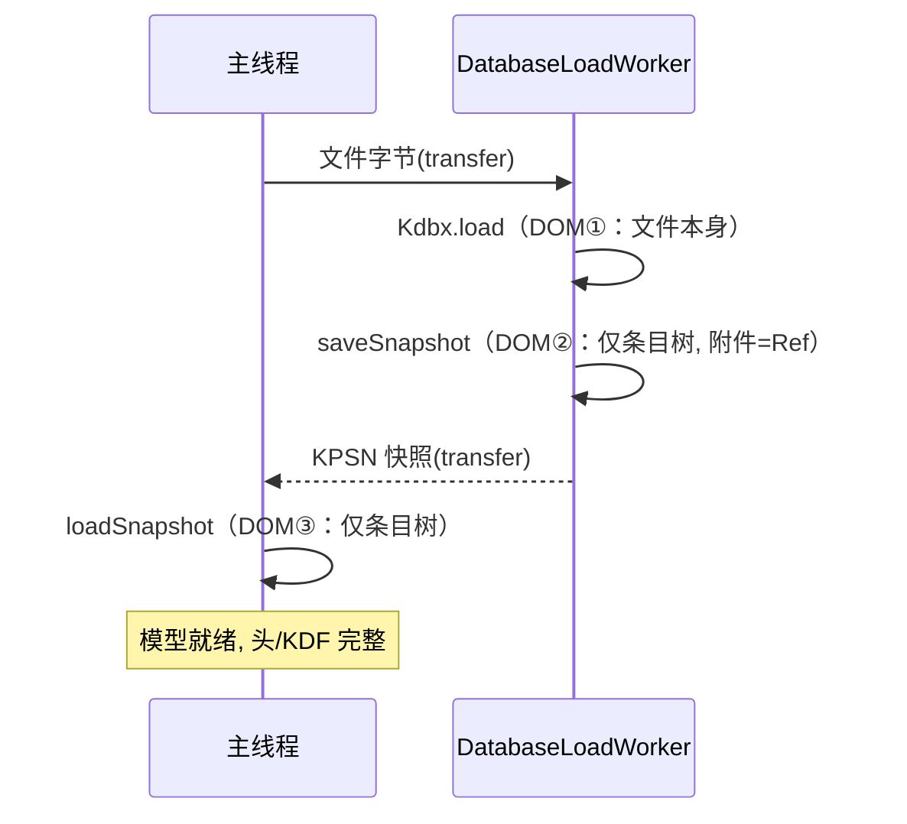

# KDBX 跨线程数据传输优化设计 —— 二进制快照协议（KPSN）

> 关联文档：[KDBX文件存储与加载流程分析.md](./KDBX文件存储与加载流程分析.md)
>
> 状态：设计已评审通过，待实施。本文档为实施的唯一依据，所有代码行号均已按当前代码核实。

---

## 目录

1. [背景与问题](#1-背景与问题)
2. [目标与非目标](#2-目标与非目标)
3. [方案选型](#3-方案选型)
4. [快照格式规范（KPSN v1）](#4-快照格式规范kpsn-v1)
5. [详细设计](#5-详细设计)
6. [分阶段实施计划](#6-分阶段实施计划)
7. [文件级变更清单](#7-文件级变更清单)
8. [测试计划](#8-测试计划)
9. [风险与回滚](#9-风险与回滚)
10. [已知限制与后续方向](#10-已知限制与后续方向)
11. [开放问题](#11-开放问题)
12. [实施记录](#12-实施记录)
- [附录 A：关键代码位置索引](#附录-a关键代码位置索引)

---

## 1. 背景与问题

### 1.1 现状

数据库模型（`Kdbx` 实例）常驻主线程，Worker 线程负责 KDBX 文件的解密/加密与 Argon2 密钥派生。两个线程之间通过 `KdbxUtils` 的两个边界函数传递模型：

```
主线程                                          Worker 线程
kdbxToArrayBuffer(kdbx)                         arrayBufferToKdbx(buf)
  = ByteUtils.stringToBuffer(                     = 先尝试 Kdbx.load()（必然失败，抛异常）
      await kdbx.saveXml())                        再回退 Kdbx.loadXml()
```

- `entry/src/main/ets/common/utils/KdbxUtils.ets:312-317`（序列化）
- `entry/src/main/ets/common/utils/KdbxUtils.ets:326-340`（反序列化）

当前 `Constants.ASYNC_LOAD_DATABASE` / `ASYNC_SAVE_DATABASE` 均为 `false`（`entry/src/main/ets/common/constants/Constants.ets:5-9`），即生产默认走同步（主线程）模式，Worker 路径存在但未启用。

### 1.2 问题一：边界上反复 XML 序列化/反序列化

以异步加载为例，一次打开数据库要经历 **3 次 DOM 级处理**：

| 步骤 | 线程 | 操作 | DOM 放大对象 |
|---|---|---|---|
| 1 | Worker | `Kdbx.load()` 解密并解析文件 XML | 全量数据（不可避免，文件格式本身） |
| 2 | Worker | `saveXml()` 重建 XML 并序列化（含 base64 附件池） | 全量数据 + base64 附件 |
| 3 | 主线程 | `loadXml()` 再解析一遍 | 全量数据 + base64 附件 |

异步保存同样有 3 次（主线程 `saveXml` → Worker `loadXml` → Worker `save()` 内 `buildXml`）。此外 `arrayBufferToKdbx` 对明文 XML 先试 `Kdbx.load` 再回退 `loadXml`，每次边界反序列化都白抛一次异常。

XML 解析器是纯 JS 的 `@xmldom/xmldom`，且 `xml-utils.ts:36` 附近在解析前还有整串正则替换，进一步放大分配。

### 1.3 问题二：大附件导致内存放大与 OOM

`saveXml()` 默认 `writeBinaries=true`（`kdbx-format.ts:202`），即把附件池以 base64 形式内联进 XML（`kdbx-meta.ts:452-460`）。以 50MB 附件为例的放大链条：

```
50MB 原始二进制
  → base64 编码 ≈ 66.7MB
  → JS UTF-16 字符串 ≈ 133MB（xml-utils 序列化/正则均产生整串）
  → xmldom DOM 节点 3~10 倍放大，峰值 > 400MB（单侧）
```

该放大在 Worker 和主线程**各发生一次**，叠加传输缓冲，实测场景必 OOM。即使不 OOM，仅 base64 编解码与 DOM 构建也是数秒级耗时。

补充一个关键事实：经 `loadXml` 还原的 `entry.binaries` 值是**裸 `ArrayBuffer`**（`kdbx-entry.ts:150`，非 `KdbxBinaryWithHash`），因此下一次 `save()` 的 `buildXml` 会把这些附件**再次 base64 内联**（`kdbx-entry.ts:159-167` 走 inline 分支）——即异步模式下附件内联与文件版本（v3/v4）无关，每次往返必然发生。

### 1.4 隐藏缺陷：XML 边界丢失文件头（本次设计顺带修复）

`loadXml()` 重建模型时直接使用默认头（`kdbx-format.ts:109`）：

```ts
loadXml(xmlStr: string): Promise<Kdbx> {
    return this.kdbx.credentials.ready.then(() => {
        this.kdbx.header = KdbxHeader.create();   // ← 默认：v4 + AES + 默认 KDF 参数
```

`KdbxHeader.create()`（`kdbx-header.ts:646-655`）给出的是"最新版本 + 默认加密套件"的头。XML 文本本身不携带文件版本、KDF 参数、cipher UUID。后果：

- **v3 文件被静默升级为 v4**：`save()` 按 `versionMajor===4` 走 `saveV4` 分支（`kdbx-format.ts:124-127`）；
- **用户调优的 KDF 参数被重置**（如把 Argon2 迭代/内存调低以加速解锁），落盘文件回到默认参数，解锁耗时无预警改变；
- 异步加载与异步保存两个方向都经过 `loadXml`，因此**只要启用异步模式，该缺陷必然触发**。

这是当前 XML 边界协议的固有缺陷（文本格式装不下二进制头），只能靠换协议解决。

---

## 2. 目标与非目标

### 目标

1. **消除附件的 XML/base64 放大**：50MB 级附件在异步模式下可正常加载/保存，不 OOM；
2. **把边界 DOM 处理量从"全量数据"降为"条目树"**：附件完全不进 XML；
3. **修复文件头丢失缺陷**：跨线程往返后版本、KDF、cipher 完整保留；
4. **边界传输零拷贝**：单块连续 `ArrayBuffer`，`postMessage` transfer list 直传；
5. **调用方零改动**：`KdbxUtils.kdbxToArrayBuffer` / `arrayBufferToKdbx` 签名不变，所有调用点无感知；
6. **可灰度、可回滚**：分阶段合入，每阶段独立可验收；最终通过开关启用异步模式。

### 非目标

- 不改变 KDBX **文件格式**（落盘字节仍由 `save()` 生成，与上游 KeePass 兼容）；
- 不改变同步模式的任何行为；
- 不在本期实现"模型常驻 Worker"（改动面过大，见 3.1）；
- 不处理 KDBX3 文件**本身**附件内联导致的加载期放大（文件格式固有，见 §10）。

---

## 3. 方案选型

### 3.1 备选方案对比

| 方案 | 思路 | 优点 | 致命缺点 | 结论 |
|---|---|---|---|---|
| B. 文件路径重载 | 主线程只传路径，Worker 自行读文件并 `Kdbx.load` | 边界零数据 | 凭据管理复杂化；每次往返重复 Argon2；合并逻辑无法复用主线程模型 | 否决 |
| C. 模型常驻 Worker | UI 通过消息代理访问模型 | 无序列化 | `FileService.getDbFileParam().database` 被数十处 UI/服务直接引用，全部改造成消息调用，改动面不可控 | 否决 |
| **A1. 快照协议（本方案）** | 自定义二进制快照：条目树 XML（仅 Ref）+ 原始二进制附件池 + 文件头 | 改动集中在 libs/kdbxweb + 2 个工具函数；附件零放大；顺带修文件头缺陷 | 条目树仍是 XML（DOM 解析保留） | **采纳** |
| A2. 纯二进制快照 | 连条目树也自定义二进制编码 | 彻底无 DOM | 编解码器要自行处理全部字段/历史/图标/自定义数据，工作量大一个数量级，风险高 | 备选（Phase 4 视压测决定） |

### 3.2 上游实现佐证

- **KeeWeb/kdbxweb**：模型只在单线程内活动，Web Worker 场景由上层（KeeWeb App）保证模型不跨线程；
- **KeePassXC**（C++/Qt）：XML 只作为文件格式存在，读写用流式 QXmlStream，**无 DOM**；附件在 KDBX4 中走内层头二进制流；
- **KeePass2Android / KeePassDX**：数据库模型常驻后台服务/单例，UI 通过进程内接口访问，不跨进程序列化。

即：成熟实现中"模型从不跨（序列化）边界传递"，XML 永远只是文件格式；附件永远是原始二进制。A1 与该共识一致。

### 3.3 结论

采用 **A1：KPSN 二进制快照协议**。条目树复用现有 `buildXml`/`loadFromXml`（仅含 Ref，体积小、风险低），附件与文件头走二进制段。若 Phase 3 压测发现万级条目的 DOM 解析仍是瓶颈，再评估 A2。

---

## 4. 快照格式规范（KPSN v1）

### 4.1 总体布局

单块连续 `ArrayBuffer`（便于一次 transfer）：

```
偏移    长度        字段
────────────────────────────────────────────────────────────────
0       4           魔数 magic = 'K','P','S','N'（0x4B 0x50 0x53 0x4E）
4       2           格式版本 formatVersion：uint16 LE，当前 = 0x0001
6       4           headerLength：uint32 LE
10      4           xmlLength：uint32 LE
14      4           poolCount：uint32 LE
18      H           Header 段（H = headerLength）
18+H    X           XML 段（X = xmlLength，UTF-8 字节）
18+H+X  —           附件池段：poolCount 个连续 TLV 记录（见 4.4）
```

固定头 18 字节。所有多字节整数**小端**，与 KDBX 文件头字段序一致，直接使用 `BinaryStream.getUint32(true)` / `setUint32(v, true)`（`libs/kdbxweb/src/main/ets/utils/binary-stream.ts:123-133`）。

选 `KPSN` 魔数的理由：4 字节可读 ASCII，且不会与 KDBX 文件魔数（`0x9AA2D90B`）、XML 文本（`<` = 0x3C）冲突，`arrayBufferToKdbx` 可以无歧义分发。

### 4.2 Header 段

内容 = `KdbxHeader.write(BinaryStream)` 的原样输出（`kdbx-header.ts:571-580`）：签名 + 版本 + 全部头字段 + EndOfHeader。恢复时用 `KdbxHeader.read(stm, ctx)`（`kdbx-header.ts:631-639`）。

- 完整保留：`versionMajor/Minor`、`kdfParameters`（KDF 算法/迭代/内存）、`dataCipherUuid`、`compression`、各类种子/IV；
- **`crsAlgorithm` 例外（v4）**：v3 中它是外层头字段，随头 blob 完整保留；v4 中它属内层头（InnerRandomStreamID），**不在外层头 blob 内**。`loadSnapshot` 恢复 v4 模型时按 `KdbxHeader.create()` 同款默认补 `CrsAlgorithm.ChaCha20`（`kdbx-header.ts:652`）——否则恢复模型下次 `save()` 时 `getProtectSaltGenerator`（`kdbx-format.ts:333-341`）抛 "bad header parameters"（实施中实测发现）；
- `write()` 会先 `validate()`，要求 masterSeed/IV 等 salts 存在；从真实文件加载的头必然合法，但**新建未落盘**的模型（`Kdbx.create` 后未 `save`）尚无 salts。因此快照序列化与 `save()`/`saveXml()`（`kdbx-format.ts:122/204`）保持同一语义，先调用 `generateSalts()` 再 `write()`。快照中的 salts 不参与后续加密（下次 `save()` 会重新生成），无保真影响。

### 4.3 XML 段

内容 = `buildXml(ctx)` → `unprotectValues` → `XmlUtils.serialize` 的输出，即与今天 `saveXml()` 产物**同一机制**，仅两点差异：

1. **附件只写 Ref**：条目二进制元素形如 `<Binary><Key>file.zip</Key><Value Ref="3"/></Binary>`，无任何 base64 内联。这不需要新逻辑——`entry.writeBinaries`（`kdbx-entry.ts:156-172`）对 `KdbxBinaryWithHash` 值天然走 `getRefByHash` → Ref 分支，**与文件版本无关**；唯一要处理的是抑制 v3 的 Meta 级附件池内联（见 5.2）；
2. **无 Meta/Binaries 节点**：附件池由 4.4 段承载。

其余一切照旧：

- **保护值**：`unprotectValues`（`xml-utils.ts:342-354`）把 `Protected="True"` 节点改写为 `ProtectedInMemPlainXml="True"` + 明文（Binary 节点为 base64）；反序列化侧 `protectPlainValues`（`xml-utils.ts:369-382`）用 `ProtectedValue.fromBase64`/`fromString` 重建（新随机盐）。与今天 `saveXml`→`loadXml` 往返完全一致，无安全退化（边界上明文本就如此）；
- **日期**：`KdbxContext.setXmlDate`（`kdbx-context.ts:14-17`）的 `isBinary = versionMajor >= 4 && !exportXml` 控制 v4 base64 秒 / v3 ISO 字符串，**无需改动**，读写两侧现有代码均支持两种形态；
- **自定义图标**：随 Meta 序列化为 base64（`kdbx-meta.ts:401` 起 `writeCustomIcons`）。图标通常几 KB~几十 KB，量级可接受，v1 不抽出（见 §11）。

### 4.4 附件池段

`poolCount` 个连续记录，**顺序 = `Kdbx.binaries` 的 `_mapByHash` 插入序**：

```
每个记录：
  uint32 LE   dataLength
  uint8       flags（bit0 = protected，即池内值为 ProtectedValue；bit1~7 保留 = 0）
  32 字节     sha256 原始哈希（模型内以 hex 字符串为键，此处存原始字节）
  dataLength 字节  附件明文数据
```

#### Ref ↔ 池序号 的关键不变量

现有代码中，写入侧的 Ref 就是 `_mapByHash` 的插入序号：

- `getRefByHash(hash)` = `[..._mapByHash.keys()].indexOf(hash)`（`kdbx-binaries.ts:91-97`）；
- `getAllWithHashes()` 按 `_mapByHash` 迭代序输出 `{hash, value}`（`kdbx-binaries.ts:105-110`）。

因此：**快照 XML 中的 `Ref="i"` ⟺ 池段第 `i` 个记录**。反序列化按序 `importPool`，同时维护 `_idToHash[i] = hash`，`entry.readBinary` → `getByRef({ref})`（`kdbx-entry.ts:144-148`、`kdbx-binaries.ts:79-89`）即可解析。该不变量已被现有 v3 文件读写（Meta/Binaries `Id` ↔ 条目 `Ref`）长期验证。

#### 数据拷贝语义

- **导出**：`ArrayBuffer` 值 `slice()` 拷贝；`ProtectedValue` 值经 `getBinary()`（`protected-value.ts:93-101`，返回新数组）取明文并置 flags.bit0。必须拷贝——模型持有活引用，快照缓冲随后被 transfer，不能共享底层存储；
- **导入**：池记录 `slice()` 出独立 `ArrayBuffer`；flags.bit0 = 1 时用 `ProtectedValue.fromBinary(data)`（`protected-value.ts:48-55`，接受所有权并以新随机盐异或）重建。`fromBinary` 重建后的明文 sha256 与导出侧一致，哈希键稳定；
- **哈希不重算**：池内直接携带 32 字节 sha256，导入侧 `bytesToHex` 生成键，**绕过** `computeHashes()` 的全量 sha256（`kdbx-binaries.ts:21-33`）。50MB 附件省一次全量哈希。

### 4.5 设计取舍记录

| 决策 | 理由 |
|---|---|
| 单块连续缓冲（而非多段消息） | `postMessage` 一次 transfer；接收方一次 `BinaryStream` 顺序读；避免多段拼装拷贝 |
| 池数据不压缩 | 边界是进程内内存，压缩省内存但耗 CPU；真实落盘压缩由 `save()` 负责 |
| 图标仍留 XML | 量级小；抽出会动 `writeCustomIcons`/`readCustomIcons` 双侧，收益低 |
| 保留 `loadXml` 回退分支 | 兼容遗留明文 XML 缓冲与测试夹具，代价为零 |

---

## 5. 详细设计

### 5.1 `KdbxContext` 新增 `snapshot` 标志

`libs/kdbxweb/src/main/ets/format/kdbx-context.ts`：

```ts
export class KdbxContext {
    readonly kdbx: Kdbx;
    exportXml: boolean;
    snapshot: boolean;          // 新增：KPSN 快照序列化进行中

    constructor(opts: { kdbx: Kdbx; exportXml?: boolean }) {
        this.kdbx = opts.kdbx;
        this.exportXml = !!opts.exportXml;
        this.snapshot = false;  // 新增
    }
    // setXmlDate 不变（isBinary 控制的是日期格式，与附件无关）
}
```

### 5.2 Meta 附件池抑制（v3 关键改动）

`libs/kdbxweb/src/main/ets/format/kdbx-meta.ts:549`：

```ts
// 现状
if (ctx.exportXml || ctx.kdbx.versionMajor < 4) {
    this.writeBinaries(node, ctx);
}
// 改为
if (!ctx.snapshot && (ctx.exportXml || ctx.kdbx.versionMajor < 4)) {
    this.writeBinaries(node, ctx);
}
```

说明：v4 + `exportXml=false` 时本就不写（现状条件为假）；v3 现状**总是**内联，必须靠 `snapshot` 抑制。条目级附件 `kdbx-entry.ts:308` 调用的 `writeBinaries` 对 `KdbxBinaryWithHash` 自动走 Ref，无需改动。

### 5.3 `KdbxBinaries.importPool`

`libs/kdbxweb/src/main/ets/format/kdbx-binaries.ts` 新增：

```ts
importPool(pool: KdbxBinaryWithHash[]): void {
    // KPSN 快照导入：按池序号重建 _mapByHash 与 _idToHash，跳过 sha256 重算
    for (let i = 0; i < pool.length; i++) {
        this._mapByHash.set(pool[i].hash, pool[i].value);
        this._idToHash.set(i.toString(), pool[i].hash);
    }
}
```

现有 `addWithHash`（`kdbx-binaries.ts:71-73`）只写 `_mapByHash` 不写 `_idToHash`，不满足 Ref 解析需要，故必须新增方法。导出侧直接复用 `getAllWithHashes()`。

后续 `loadFromXml` 中的 `computeHashes()`（`kdbx.ts:573`）成为无害空操作：`_mapById` 为空 → `Promise.all([])` → 清空空表，**不需要改 `loadFromXml`**。

### 5.4 序列化：`Kdbx.saveSnapshot()`

逻辑放在新文件 `libs/kdbxweb/src/main/ets/format/kdbx-snapshot.ts`（编解码器主体），`kdbx.ts` 暴露薄包装（与 `saveXml` 的暴露方式对齐）。流程（对照 `saveXml`，`kdbx-format.ts:202-216`）：

```ts
saveSnapshot(): Promise<ArrayBuffer> {
    return this.kdbx.credentials.ready.then(() => {
        // 1. 快照模式构建 XML（header.write 校验需要 salts，先 generateSalts）
        this.ctx.snapshot = true;
        try {
            this.kdbx.buildXml(this.ctx);            // meta 跳过 Binaries；条目附件 → Ref
        } finally {
            this.ctx.snapshot = false;               // 异常也不能泄漏标志
        }
        if (!this.kdbx.xml) { throw new KdbxError(ErrorCodes.InvalidState, 'no xml'); }

        // 2. 保护值按 saveXml 同款机制落明文标记
        XmlUtils.unprotectValues(this.kdbx.xml.documentElement);
        const xml = XmlUtils.serialize(this.kdbx.xml);
        XmlUtils.protectUnprotectedValues(this.kdbx.xml.documentElement);
        this.cleanXml();

        // 3. 头段
        const headerStm = new BinaryStream();
        this.kdbx.header.write(headerStm);           // 含 validate()

        // 4. 附件池段（getAllWithHashes 保序；Ref 序号即下标）
        const pool = this.kdbx.binaries.getAllWithHashes();

        // 5. 拼装 KPSN 缓冲（示意：先算长度或分块写入 BinaryStream）
        const out = new BinaryStream();
        out.writeBytes(SNAPSHOT_MAGIC);              // 'KPSN'
        out.setUint16(SNAPSHOT_VERSION, true);
        out.setUint32(headerLen, true);
        out.setUint32(xmlBytesLen, true);
        out.setUint32(pool.length, true);
        out.writeBytes(headerStm.getWrittenBytes());
        out.writeBytes(xmlBytes);
        for (const item of pool) {
            // ArrayBuffer → slice 拷贝；ProtectedValue → getBinary() + flags.bit0
            // 哈希：hexToBytes(item.hash) 原始 32 字节
        }
        return out.getWrittenBytes();
    });
}
```

实现注意：

- `BinaryStream` 写入是容量倍增策略（`binary-stream.ts:48-61`），50MB 池会经历 log₂ 次扩容拷贝，可接受；若压测敏感，可先累加各段长度、一次性 `new ArrayBuffer(total)` 后用 `DataView`/`Uint8Array` 直写（优化项，不阻塞）；
- `stringToBytes(xml)` 产生 UTF-8 字节（复用 `byte-utils`）。

### 5.5 反序列化：`Kdbx.loadSnapshot()`

静态方法，与 `Kdbx.loadXml` 对齐暴露。流程（对照 `loadXml`，`kdbx-format.ts:107-117`）：

```ts
static loadSnapshot(data: ArrayBuffer, credentials: KdbxCredentials): Promise<Kdbx> {
    // 1. 解析固定头 + 魔数/版本校验（不匹配 → KdbxError(FileCorrupt)）
    // 2. 恢复文件头 —— 修复 1.4 缺陷的关键
    const header = KdbxHeader.read(new BinaryStream(headerBlob), ctx);
    kdbx.header = header;                            // 真实版本/KDF/cipher，而非 KdbxHeader.create()

    // 3. 附件池先行导入（必须在 loadFromXml 之前，Ref 才能解析）
    const pool = /* 逐记录读出，slice 拷贝，ProtectedValue.fromBinary 重建 */;
    kdbx.binaries.importPool(pool);                  // _mapByHash + _idToHash，无 sha256

    // 4. XML 解析（与 loadXml 相同机制）
    kdbx.xml = XmlUtils.parse(xmlStr);
    XmlUtils.protectPlainValues(kdbx.xml.documentElement);
    return kdbx.loadFromXml(ctx).then(() => {        // parseMeta（无 Binaries 节点，自然跳过）
        this.cleanXml();                             // computeHashes 空操作；parseRoot 解析 Ref
        return kdbx;
    });
}
```

`kdbx` 实例与 `ctx` 的构造方式与 `Kdbx.loadXml` 现有实现保持一致（`credentials.ready` 等待亦同）。

### 5.6 `KdbxUtils` 接入（调用方零改动）

`entry/src/main/ets/common/utils/KdbxUtils.ets`：

```ts
// kdbxToArrayBuffer（312-317）：仅改一行
return Promise.resolve(await kdbx.saveSnapshot());          // 原: stringToBuffer(await kdbx.saveXml())

// arrayBufferToKdbx（326-340）：前置魔数分发
public static async arrayBufferToKdbx(arrayBuffer, credentialsParam, credentials?) {
    if (arrayBuffer instanceof Kdbx) { return arrayBuffer; }
    if (credentials == undefined) { credentials = await CredentialsService.createKdbxCredentials(credentialsParam); }
    if (KdbxSnapshot.isSnapshot(arrayBuffer)) {             // 新增：读前 6 字节判断 'KPSN' + 版本
        return Kdbx.loadSnapshot(arrayBuffer, credentials);
    }
    try {
        return await Kdbx.load(arrayBuffer, credentials);   // 保持不变（真实加密文件）
    } catch (error) {
        return Kdbx.loadXml(ByteUtils.bytesToString(arrayBuffer), credentials);  // 保持不变（遗留明文 XML）
    }
}
```

`isSnapshot` 只读前 6 字节，无异常路径。`kdbxToArrayBuffer` 的 `ArrayBuffer` 直通分支（313-315 行）保留。

### 5.7 Worker 协议变更

#### 异步加载（`DatabaseLoadWorker.ets` / `DatabaseLoad.ets`）

Worker 内 `Kdbx.load` 成功后，原 `saveXml()` 改为 `saveSnapshot()`；`SuccessMessage.data` 语义从"XML 缓冲"变为"KPSN 快照缓冲"，字段类型不变（仍是 `ArrayBuffer`），transfer list 用法不变。主线程 `arrayBufferToKdbx` 自动分发到 `loadSnapshot`。**主线程的一次全量 DOM 解析与 base64 解码消失**。

#### 异步保存请求（`DatabaseSave.ets` 主线程侧）

主线程 `kdbxToArrayBuffer(kdbx)` 自动产出快照缓冲，`postMessage(req, [req.data])` 用法不变。

#### 异步保存成功（`DatabaseSaveWorker.ets`）——两处修复

1. `postSuccessMessage` **当前没有 transfer list**（拷贝发送），补上 `[savedData.buffer]`（及快照缓冲）；
2. `isMerge` 场景：Worker 合并后除 KDBX 落盘字节外，**追加返回合并后模型的快照**：

```ts
interface SaveSuccessMessage {
    data: ArrayBuffer;        // KDBX 文件字节（写存储用），语义不变
    snapshot?: ArrayBuffer;   // 新增：isMerge 时合并后模型的 KPSN 快照
}
```

`KdbxSaveService` 的 `isMerge` 处理从"对 KDBX 字节做 `arrayBufferToKdbx` 全量重解析（含主线程 Argon2！）"改为"`arrayBufferToKdbx(snapshot)`"，直接得到模型——**主线程 Argon2 与一次完整解密解析被消除**。

#### 修复后的异步时序



```mermaid
sequenceDiagram
    participant M as 主线程
    participant W as DatabaseSaveWorker
    M->>M: saveSnapshot（DOM①：仅条目树）
    M->>W: KPSN 快照(transfer)
    W->>W: loadSnapshot（DOM②：仅条目树）
    W->>W: kdbx.save()（DOM③：buildXml, 附件走内层头/池）
    W-->>M: KDBX字节 + (isMerge)合并快照(transfer)
    M->>M: 写存储; isMerge→loadSnapshot(合并快照)
```

对比现状：3 个"全量 DOM（含 base64 附件）"变为 1 个全量 DOM（Worker 内文件解析，不可避免）+ 若干"小 DOM（仅条目树）"。

---

## 6. 分阶段实施计划

| 阶段 | 内容 | 交付物 | 验收 | 开关状态 |
|---|---|---|---|---|
| **Phase 1** 协议编解码 ✅ 2026-10-05（见 §12） | libs/kdbxweb：`kdbx-snapshot.ts`、`KdbxContext.snapshot`、meta 抑制、`importPool`、`saveSnapshot`/`loadSnapshot`；`KdbxUtils` 魔数分发 | 编解码可用；单测通过 | §8.1 全绿；round-trip 无损 | `ASYNC_*=false`（生产不受影响） |
| **Phase 2** Worker 协议 ✅ 2026-10-05（见 §12） | Load/Save worker 消息切换为快照；`postSuccessMessage` transfer list 修复；isMerge 快照回传 | 异步链路端到端走快照 | §8.2 全绿（扩展后的 `DatabaseWorkerMode.test.ets`） | `ASYNC_*=false` |
| **Phase 3** 压测与启用 | 基准测试（§8.3）；按数据翻转 `Constants.ASYNC_LOAD_DATABASE` / `ASYNC_SAVE_DATABASE`；真机验证 | 异步模式默认开启 | §8.4 量化指标达成 | `ASYNC_*=true` |
| **Phase 4** 可选增强 | Sendable 懒加载附件池；A2 纯二进制快照评估；KDBX3 升级引导；附件上限策略调整 | 视 Phase 3 数据决定 | — | — |

每阶段独立成 commit/PR，Phase 1/2 合入后生产路径行为不变（开关仍关），风险受控。

---

## 7. 文件级变更清单

### libs/kdbxweb（`libs/kdbxweb/src/main/ets/`）

| 文件 | 变更 | 性质 |
|---|---|---|
| `format/kdbx-snapshot.ts` | **新建**：魔数/版本常量、`isSnapshot()`、`serialize`/`load` 编解码主体 | 新增 |
| `format/kdbx-context.ts` | 新增 `snapshot` 属性（`setXmlDate` 不动） | 修改 |
| `format/kdbx-meta.ts:549` | 写 Binaries 条件增加 `!ctx.snapshot` | 修改（1 行） |
| `format/kdbx-binaries.ts` | 新增 `importPool(pool)` | 新增方法 |
| `format/kdbx.ts` | 暴露 `saveSnapshot()` / 静态 `loadSnapshot()`（对齐 `saveXml`/`loadXml` 的组合方式） | 新增薄包装 |
| `utils/binary-stream.ts` | 无改动（现有 API 足够） | — |
| `utils/xml-utils.ts` | 无改动 | — |
| `crypto/protected-value.ts` | 无改动（复用 `fromBinary`/`getBinary`） | — |

### entry（`entry/src/main/ets/`）

| 文件 | 变更 | 阶段 |
|---|---|---|
| `common/utils/KdbxUtils.ets:312-317,326-340` | `kdbxToArrayBuffer` 改调 `saveSnapshot`；`arrayBufferToKdbx` 前置魔数分发 | P1 |
| `workers/DatabaseLoadWorker.ets`、`services/kdbx/DatabaseLoad.ets`（worker 侧任务逻辑） | 成功消息载体：XML → 快照 | P2 |
| `workers/DatabaseSaveWorker.ets` | `postSuccessMessage` 补 transfer list；isMerge 追加 `snapshot` 字段 | P2 |
| `services/kdbx/DatabaseSave.ets`（worker 任务）/`KdbxSaveService.ets` | isMerge 用快照重建模型；消息类型扩展 | P2 |
| `common/constants/Constants.ets:5-9` | 翻转 `ASYNC_LOAD_DATABASE`/`ASYNC_SAVE_DATABASE` | P3 |

### 测试（新建/扩展）

| 文件 | 内容 | 阶段 |
|---|---|---|
| `libs/kdbxweb/src/ohosTest/`（或 entry 侧 test，按现有用例布局）`KdbxSnapshot.test.ets` | §8.1 单测 | P1 |
| `entry/src/ohosTest/ets/test/workers/DatabaseWorkerMode.test.ets` | §8.2 扩展 | P2 |
| `libs/kdbxweb/scripts/make-big-files.ts` | 生成基准数据（现有脚本，按需补 50MB 附件场景） | P3 |

---

## 8. 测试计划

### 8.1 单元测试（Phase 1）

| 用例 | 断言 |
|---|---|
| v4 文件 round-trip | `Kdbx.load(文件)` → `saveSnapshot` → `loadSnapshot` → 深比较：组/条目/字段/保护值（`getText` 相等）/附件字节相等/图标/历史条目/回收站/自定义数据 |
| v3 文件 round-trrip | 同上，且 `versionMajor===3`、`keyEncryptionRounds` 保持（**回归 1.4 缺陷**） |
| v4 KDF 保持 | 构造非默认 Argon2 参数（如 I=1, M=16MB）文件，往返后 `kdfParameters` 逐项相等 |
| 大附件 | 5MB / 50MB 合成附件：round-trip 字节相等；记录耗时与峰值内存（基线数据） |
| 重复附件 | 同一附件被多条目引用（同 hash 去重）：池仅 1 条，两个 Ref 均解析成功 |
| 保护型附件 | 池内 `ProtectedValue`：flags.bit0 往返正确，明文字节相等 |
| 空池 / 无附件 | `poolCount=0` 正常往返 |
| 损坏输入 | 截断缓冲、坏魔数、坏版本号 → `KdbxError(FileCorrupt)`，不崩溃 |
| `isSnapshot` 分发 | KPSN / KDBX 文件 / 明文 XML 三种输入各归各路 |
| 标志复位 | 序列化中途抛异常（mock `buildXml` 失败）后 `ctx.snapshot===false` |

### 8.2 Worker 集成测试（Phase 2，扩展 `DatabaseWorkerMode.test.ets`）

- 异步加载 → 保存 → 再加载闭环，数据无损；
- isMerge 冲突路径：`snapshot` 字段存在、主线程模型与 Worker 合并结果一致、主线程无 Argon2 调用（可通过打点/耗时断言）；
- transfer list 生效：发送后原缓冲 `byteLength` 访问抛 ` detached`（或改用行为断言：大文件路径无额外拷贝耗时）；
- 异常路径：Worker 抛错时主线程收到错误消息（既有机制不回归）。

### 8.3 基准测试（Phase 3）

数据集（`make-big-files.ts` 生成，配合 `kdbx-size-profiler.ts`）：

| 场景 | 构成 |
|---|---|
| A | 1 条目 × 50MB 附件 |
| B | 10 条目 × 5MB 附件 |
| C | 10,000 条目无附件 |
| D | 现有测试库（回归基准） |

指标：异步加载/保存墙钟时间、Worker 与主线程峰值内存（`hidebug` PSS / Profiler）、UI 帧率（保存/加载期间）。

### 8.4 验收标准（量化）

| 指标 | 现状（估算/实测） | 目标 |
|---|---|---|
| 场景 A 异步加载峰值内存 | > 500MB（OOM） | Worker < 250MB，主线程 < 150MB，不 OOM |
| 场景 A 异步保存 | OOM | 同上量级，成功落盘 |
| 场景 A 加载+保存墙钟 | 不可用 | < 5s（真机，含 Argon2） |
| 场景 C 异步 vs 同步耗时 | — | ≤ 1.5× |
| v3 文件异步往返 | 静默升 v4 | 保持 v3，KDF 参数逐项相等 |
| isMerge 主线程耗时 | 含完整解密重解析 | 无 Argon2，仅小 DOM 解析 |

---

## 9. 风险与回滚

| 风险 | 概率 | 缓解 |
|---|---|---|
| 快照编解码 bug 导致数据错乱 | 低 | 单测覆盖 round-trip 字节级相等；Phase 1/2 期间生产开关关闭，协议仅被测试触达；Phase 3 先真机灰度 |
| `snapshot` 标志泄漏（异常路径未复位） | 低 | `try/finally` 复位（5.4）+ 专项单测（8.1 末行） |
| Ref/池序号错位导致附件串位 | 低 | 序号不变量直接复用 v3 文件长期验证过的 `Id↔Ref` 机制；重复附件/多附件专项用例 |
| Worker 消息新旧格式混用 | 极低 | 同一 HAP 原子升级，进程重启后 Worker 重建，不存在跨版本在途消息；`loadXml` 回退分支兜底 |
| `BinaryStream` 大缓冲扩容拷贝 | 中 | 可选优化：预计算总长一次分配（5.4 注意事项）；Phase 3 压测确认 |
| 内存回落不及预期 | 低 | Phase 3 基准先行，未达标不翻开关 |

**回滚方案**：任意阶段回滚 = 翻回 `Constants` 开关（回同步模式，快照代码休眠）或 revert 对应 commit；`KdbxUtils` 的魔数分发保证回滚后旧 XML 路径完好。落盘文件始终由 `save()` 生成，**用户数据文件不受协议切换影响**。

---

## 10. 已知限制与后续方向

1. **KDBX3 文件本身的附件内联**：v3 格式把附件 base64 写在 XML 里，`Kdbx.load()` 解析 v3 大附件文件时仍有放大（与边界协议无关，文件格式固有）。缓解方向：加载后提示升级为 v4（KeePass 官方亦推荐），Phase 4 做引导。
2. **条目树仍是 XML**：万级条目下 Worker/主线程各有一次小 DOM 解析。若 Phase 3 场景 C 不达标，启动 A2（纯二进制条目树）。
3. **附件上限**：`EntryEdit.ets` 目前限 5MB/文件；协议层面 50MB+ 已可行，产品侧是否放宽另行决策（§11）。
4. **Sendable 懒加载（Phase 4）**：SDK 6.1.0(23) 支持 `collections.ArrayBuffer` 共享，附件池可改为跨线程共享 + 按需取值，进一步消除边界拷贝。
5. **既有小缺陷（本设计不改，仅记录）**：`entry.writeBinaries` 在 `getRefByHash` 未命中时 `return` 中断整条目剩余附件写入（`kdbx-entry.ts:161-163`，应为 `continue`）；快照模式下池序号与导出同源，不会触发，但顺带修复可另行提 `fix:`。

---

## 11. 开放问题

| # | 问题 | 建议 | 决策点 |
|---|---|---|---|
| 1 | 附件 UI 上限是否从 5MB 放宽 | Phase 3 压测数据出来后决定 | Phase 3 |
| 2 | 快照缓冲是否 gzip 压缩 XML 段 | 不压（进程内带宽免费，压缩耗 CPU）；若场景 C 显示 XML 段 > 20MB 再议 | Phase 3 |
| 3 | 自定义图标是否移入二进制段 | 暂不移；图标超过若干 MB 属异常库，遇到再优化 | Phase 4 |
| 4 | `kdbx-snapshot.ts` 放 libs/kdbxweb 还是 entry | libs/kdbxweb（与格式代码同库，可独立单测） | 已定 |

---

## 12. 实施记录

### 12.1 Phase 1 + Phase 2（2026-10-05 完成）

| 项 | 结果 |
|---|---|
| 代码变更 | §7 清单全部落地；`DatabaseLoadWorker.ets` 无需改动（经 `KdbxUtils` 魔数分发自动切换） |
| 测试 | KdbxSnapshotTest 10/10、DatabaseWorkerModeTest 6/6（快照断言扩展）、DatabaseSyncModeTest 7/7；导入导出 106、OTP 53、KdbxError/TotpService/FileUtils/RecentFiles/SyncSettings 等既有套件回归全绿（模拟器实跑，真实加密无 mock） |
| 生产开关 | `ASYNC_*=false` 未翻转，生产行为不变（Phase 3 待做） |

实施与原设计的差异（均已回写本文档）：

1. **`saveSnapshot` 先 `generateSalts()`**（§4.2）：实测 `Kdbx.create()` 新建模型无 salts，直接 `header.write()` 在 `validate()`（`kdbx-header.ts:490-492`）抛 "no master seed in header"，与 `save()`/`saveXml()` 语义对齐后修复；
2. **`loadSnapshot` 为 v4 补 `crsAlgorithm = ChaCha20`**（§4.2）：v4 内层头字段不在快照头 blob 内，缺失导致恢复模型下次 `save()` 抛 "bad header parameters"（`kdbx-format.ts:333-341`）；
3. Worker 侧落地形态：`DatabaseSave.mergeDatabase` 返回合并后 `Kdbx` 实例，`postSuccess(request, content, isMerge, database?)` 在 isMerge 时附加 `message.snapshot = await database.saveSnapshot()`（§5.7 的 `SaveSuccessMessage` 落地为 `WorkerParam.SuccessMessage.snapshot?: ArrayBuffer`）；transfer list = `[message.data, ...snapshot]`；
4. 测试文件位置：`KdbxSnapshot.test.ets` 放 `entry/src/ohosTest/ets/test/kdbx/`（entry_test 为项目规定的可运行测试模块），在 `List.test.ets` 注册。

实施期注意点（测试编写相关）：

- `ProtectedValue.fromBinary` 就地销毁入参（XOR 置乱，所有权转移，`protected-value.ts:48-55`），断言前需保留 pristine 副本；
- `loadSnapshot`（及 v4 文件加载）后条目附件为 `KdbxBinaryWithHash`（下次落盘走 Ref）；`kdfParameters`/`keyEncryptionRounds` 为 `| undefined`，断言前需判空。

### 12.2 环境依赖套件的补充回归

- 2026-10-05 WebDAV 回归：`WebDavTest` 9/9（bytemark/webdav 容器 + rport 隧道，搭建见 `docs/e2e/webdav/webdav-server.md`），基线同步至 `docs/storage-regression-test.md` §6；
- S3 RealAPI / 华为网盘 / pCloud 真实用例：按门控约定未注册或需外部环境（MinIO/凭证），不在本轮范围。

---

## 附录 A：关键代码位置索引

（均已在本次设计中核实）

| 位置 | 说明 |
|---|---|
| `entry/src/main/ets/common/utils/KdbxUtils.ets:312-317` | `kdbxToArrayBuffer`：`saveXml` → 改 `saveSnapshot` |
| `entry/src/main/ets/common/utils/KdbxUtils.ets:326-340` | `arrayBufferToKdbx`：try `Kdbx.load` / catch `loadXml` → 前置魔数分发 |
| `entry/src/main/ets/common/constants/Constants.ets:5-9` | `ASYNC_LOAD_DATABASE` / `ASYNC_SAVE_DATABASE`（当前均 false） |
| `libs/kdbxweb/src/main/ets/format/kdbx-format.ts:107-117` | `loadXml`；`:109` 默认头缺陷 |
| `libs/kdbxweb/src/main/ets/format/kdbx-format.ts:119-135` | `save()`：`generateSalts` + v3/v4 分支 |
| `libs/kdbxweb/src/main/ets/format/kdbx-format.ts:202-216` | `saveXml()`：`generateSalts`(204)、`exportXml`(205) |
| `libs/kdbxweb/src/main/ets/format/kdbx.ts:564-577` | `loadFromXml`：parseMeta → `computeHashes`(573) → parseRoot |
| `libs/kdbxweb/src/main/ets/format/kdbx.ts:630-639` | `buildXml` |
| `libs/kdbxweb/src/main/ets/format/kdbx-meta.ts:549-551` | Meta 附件池内联条件（**核心 1 行改动**） |
| `libs/kdbxweb/src/main/ets/format/kdbx-meta.ts:432-460` | Meta 附件池读（`addWithId`）/写（`getAll`） |
| `libs/kdbxweb/src/main/ets/format/kdbx-binaries.ts:21-33` | `computeHashes`（快照绕过） |
| `libs/kdbxweb/src/main/ets/format/kdbx-binaries.ts:71-73` | `addWithHash`（无 `_idToHash`，故需 `importPool`） |
| `libs/kdbxweb/src/main/ets/format/kdbx-binaries.ts:79-110` | `getByRef` / `getRefByHash` / `getAllWithHashes`（序号不变量） |
| `libs/kdbxweb/src/main/ets/format/kdbx-entry.ts:137-154` | 条目附件读取：Ref → `getByRef`，未命中静默丢弃 |
| `libs/kdbxweb/src/main/ets/format/kdbx-entry.ts:156-172` | 条目附件写入：WithHash → Ref，裸值 → 内联 |
| `libs/kdbxweb/src/main/ets/format/kdbx-header.ts:571-580` | `KdbxHeader.write`（头段序列化） |
| `libs/kdbxweb/src/main/ets/format/kdbx-header.ts:631-655` | `static read` / `create`（默认头来源） |
| `libs/kdbxweb/src/main/ets/format/kdbx-context.ts:14-17` | `setXmlDate` 的 `isBinary`（日期格式，勿动） |
| `libs/kdbxweb/src/main/ets/utils/xml-utils.ts:342-382` | `unprotectValues` / `protectUnprotectedValues` / `protectPlainValues` |
| `libs/kdbxweb/src/main/ets/utils/binary-stream.ts:99-133` | `getUint16/setUint16/getUint32/setUint32(LE)` |
| `libs/kdbxweb/src/main/ets/crypto/protected-value.ts:48-55,93-101` | `fromBinary` / `getBinary` |
| `entry/src/main/ets/workers/DatabaseLoadWorker.ets`、`DatabaseSaveWorker.ets` | Worker 消息层（P2 变更点） |
| `entry/src/main/ets/services/kdbx/KdbxLoadService.ets`、`KdbxSaveService.ets` | 异步编排与 isMerge（P2/P3 变更点） |
| `entry/src/ohosTest/ets/test/workers/DatabaseWorkerMode.test.ets` | Worker 模式测试（P2 扩展） |
| `libs/kdbxweb/scripts/make-big-files.ts` | 基准数据生成（P3） |
